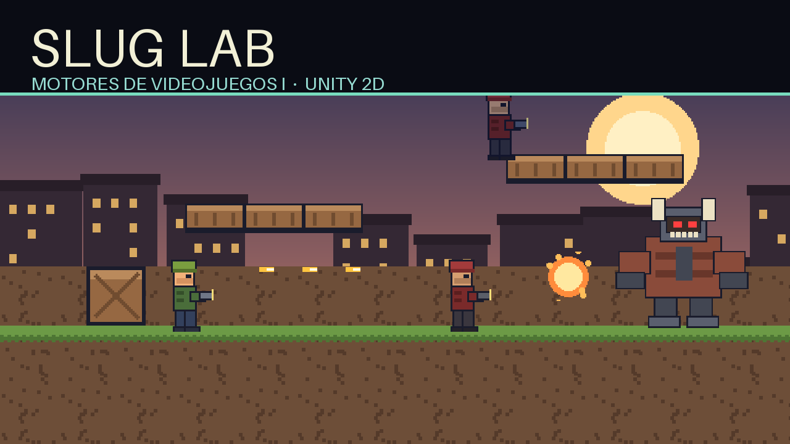

# Slug Lab · Motores de Videojuegos I

**Un proyecto de Unity 2D para aprender a hacer un juego tipo Metal Slug, de cero y con las manos en el motor.**

Repositorio del curso para la carrera de **Animación**. El objetivo no es solo que el juego funcione: es que cada alumno entienda *por qué* funciona, sepa diagnosticar cuando no, y termine con un nivel propio jugable, dibujado y animado por él mismo.



---

## Qué vas a encontrar aquí

| Pieza | Para qué sirve |
|---|---|
| `Assets/_SlugLab/Scenes/Juego/` | El juego de referencia completo: menú, Nivel 1 (La Cantina) y Nivel 2 (El Jefe). |
| `Assets/_SlugLab/Scenes/Laboratorio/` | 10 escenas de práctica, una por tema, con objetivos y casos de prueba. |
| `Assets/_SlugLab/Scripts/` | El framework comentado: jugador, combate, IA, jefe, cámara, HUD, audio. |
| `Assets/_SlugLab/Tests/` | 42 pruebas automatizadas (EditMode y PlayMode) que definen qué significa "está bien". |
| `Assets/_SlugLab/Shaders/` | Shader `SpriteFlash`: destello de daño y disolución por umbral. |
| `Assets/_Curso/Bugs/` | 4 bugs reales para cazar, con tests que fallan hasta que los corrijas. |
| `Assets/_Curso/MiJuego/` | Tu espacio: aquí construyes tu propio nivel, con tus dibujos. |
| `docs/` | Calendario de 42 sesiones, guías, rúbricas, catálogo de pruebas y especificación de arte. |

## Empezar en 5 minutos

1. Instala **Unity 6000.3.10f1** (Unity Hub → Installs).
2. Clona el repositorio y ábrelo con Unity Hub (**Add project from disk**).
3. Espera la primera importación (2–5 min).
4. Abre `Assets/_SlugLab/Scenes/Juego/Menu.unity` y pulsa **Play**.
5. Lee [`docs/00-empezar.md`](docs/00-empezar.md) para el recorrido completo.

> Si las escenas aparecen vacías o con errores, ejecuta el menú **Slug Lab → 3. Generar juego completo**. Regenera prefabs, animaciones y escenas desde cero.

## Controles

| Acción | Teclado | Ratón |
|---|---|---|
| Moverse | `A` / `D` o flechas | — |
| Saltar | `Espacio` | — |
| Disparar | `J` | clic izquierdo |
| Cuchillo | `K` | clic derecho |
| Agacharse | `S` o `Ctrl` | — |
| Recargar | `R` | — |
| Pausa | `Esc` | — |

## Cómo trabaja el alumno

Cada alumno crea **su propio repositorio** a partir de la plantilla y trabaja en
`Assets/_Curso/MiJuego/`: ahí van sus escenas, prefabs, scripts y arte. El
material de `Assets/_SlugLab/` se lee y se copia, **no se edita**. Los reportes
de laboratorio van en `entregas/`.

El flujo completo (crear el repo, clonar, qué tocar y qué no, cómo entregar)
está en [`docs/06-flujo-git.md`](docs/06-flujo-git.md) y en
[`Assets/_Curso/MiJuego/README.md`](Assets/_Curso/MiJuego/README.md).

## Mapa del curso

Son **42 sesiones de 90 minutos** (11 ene – 7 may 2027), dos exámenes parciales y entrega final el **viernes 14 de mayo de 2027**. El detalle día por día está en [`docs/01-calendario.md`](docs/01-calendario.md).

| Módulo | Sesiones | Tema | Escena |
|---|---|---|---|
| M00 | 3 | Arranque: Git, Unity y estructura de proyecto | — |
| M01 | 3 | Sprites: importar, recortar, ordenar | `Lab_01_Sprites` |
| M02 | 4 | Animación 2D: clips, Animator, eventos | `Lab_02_Animacion` |
| M03 | 4 | Física 2D: colisiones, salto, plataformas | `Lab_03_Fisica` |
| M04 | 4 | Combate: hitboxes, daño, pooling | `Lab_04_Combate` |
| M05 | 4 | Enemigos e IA: máquinas de estado | `Lab_05_IA` |
| — | 1 | **Parcial 1** (revisión de avance) | — |
| M06 | 4 | Niveles: tilemap, cámara, checkpoints | `Lab_06_Niveles` |
| M07 | 4 | Interfaz y flujo: HUD, pausa, guardado | `Lab_07_UI` |
| M08 | 3 | Audio y *game feel*: shake, hitstop, SFX | — |
| M11 | 1 | VFX y shaders: flash, dissolve y partículas | `Lab_10_VFX` |
| — | 1 | **Parcial 2** (revisión de avance) | — |
| M09 | 4 | Jefe final: fases, patrones, telegrafía | `Lab_08_Jefe` |
| M10 | 2 | Cierre: build, itch.io, portafolio | — |
| — | — | **Entrega final: viernes 14 de mayo** | — |

## Cómo se evalúa

Tres notas que se acumulan:

- **Escenarios de práctica (40 %):** cada laboratorio tiene casos de prueba; se entrega captura o GIF de cada uno cumplido.
- **Cacería de bugs (20 %):** activas el define `BUG_HUNT`, ves los 4 tests en rojo y los pones en verde sin cambiar los tests.
- **Juego propio (40 %):** un nivel jugable con tu personaje, tus enemigos y tu jefe, más el reporte de pruebas. Rúbrica en [`docs/03-evaluacion.md`](docs/03-evaluacion.md).

## Pruebas automatizadas

```bash
# EditMode (lógica y configuración del proyecto)
Unity.exe -batchmode -runTests -testPlatform EditMode -testResults resultados.xml

# PlayMode (física, escenas, combate)
Unity.exe -batchmode -runTests -testPlatform PlayMode -testResults resultados.xml
```

En el editor: **Window → General → Test Runner**. Los IDs `TC-01`…`TC-36` del catálogo [`docs/04-casos-de-prueba.md`](docs/04-casos-de-prueba.md) coinciden con los nombres de los tests.

## Estructura del repositorio

```
slug-lab/
├─ Assets/
│  ├─ _SlugLab/          # el juego y el material del curso
│  │  ├─ Art/            # sprites placeholder generados
│  │  ├─ Editor/         # herramientas: setup, importador, generador de escenas
│  │  ├─ Prefabs/        # jugador, enemigos, jefe, balas
│  │  ├─ Resources/      # SFX y música
│  │  ├─ Scenes/         # Juego/ y Laboratorio/
│  │  ├─ Scripts/        # framework (Core, Combat, Player, Enemies, Boss, Level, UI, VFX)
│  │  ├─ Shaders/        # SpriteFlash: flash de daño y dissolve
│  │  ├─ Settings/       # ScriptableObjects: armas, enemigos, tiles, clips, materiales
│  │  └─ Tests/          # EditMode y PlayMode
│  └─ _Curso/            # tu zona de trabajo
│     ├─ Bugs/           # cacería de bugs
│     ├─ MiJuego/        # tu nivel
│     └─ Plantillas/
├─ docs/                 # calendario, guías, rúbricas, catálogo
├─ plantillas/           # entregables en Markdown
├─ entregas/             # reportes que sube el alumno
├─ tools/                # generadores de arte y audio (Python)
└─ .github/              # plantillas de issue y PR
```

## Compilar para Windows, Android y WebGL

- **Windows:** `File → Build Settings → Windows` o el build por defecto.
- **Android:** `Slug Lab → 6. Build Android (APK)` (requiere el módulo Android, ya instalado).
- **WebGL:** `Slug Lab → 7. Build WebGL` (requiere instalar *WebGL Build Support* en Unity Hub).

En móvil aparecen joystick y botones automáticamente; en el editor se prueban en `Lab_07_UI`. Detalle en [`docs/08-multiplataforma.md`](docs/08-multiplataforma.md).

En **WebGL** hay un botón de pantalla completa, y en **Android/WebGL** el juego se pausa solo cuando la app pierde el foco.

## Regenerar el contenido base

El arte y el audio son **placeholder generados por código** para que el proyecto pese poco y sea reproducible:

```bash
python tools/generar_arte.py     # 60+ sprites en Assets/_SlugLab/Art
python tools/generar_audio.py    # 12 SFX + 1 loop de música
```

Y dentro de Unity: **Slug Lab → 3. Generar juego completo**.

## Requisitos

- Unity **6000.3.10f1** (URP 2D, Input Manager clásico).
- Git y una cuenta de GitHub.
- Para los docentes: Python 3.10+ solo si quieren regenerar arte/audio.

## Licencia y créditos

Código bajo licencia MIT (ver [`LICENSE`](LICENSE)). El arte placeholder es original y puede usarse libremente en clase. Los nombres de personajes y el estilo *run and gun* son homenaje; no se usa ningún recurso de Metal Slug.

Hecho para la materia **Motores de Videojuegos I**, carrera de Animación.
